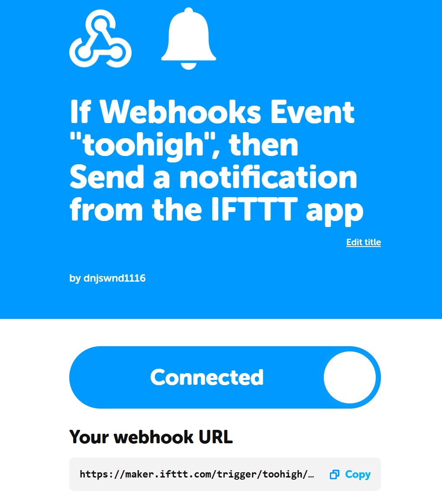
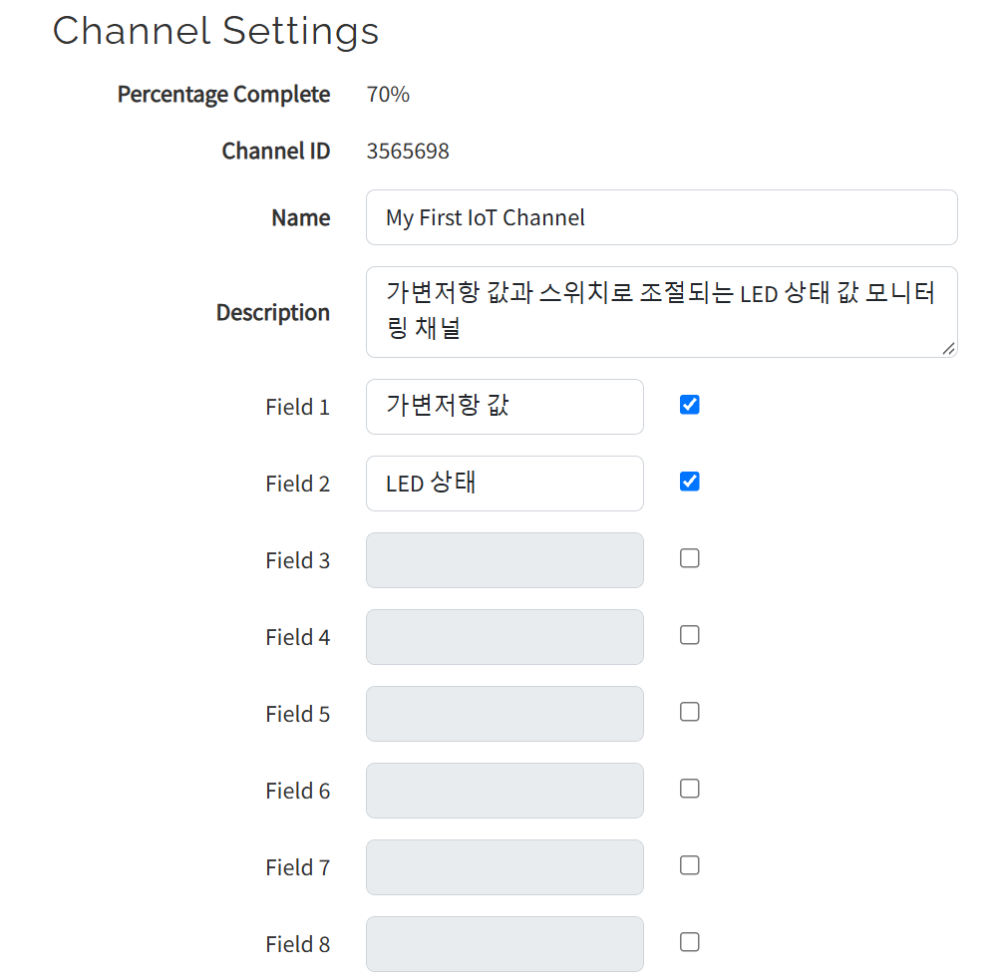
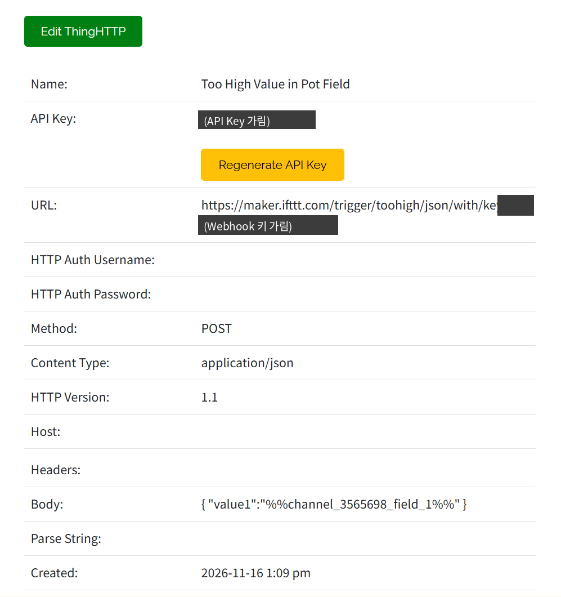
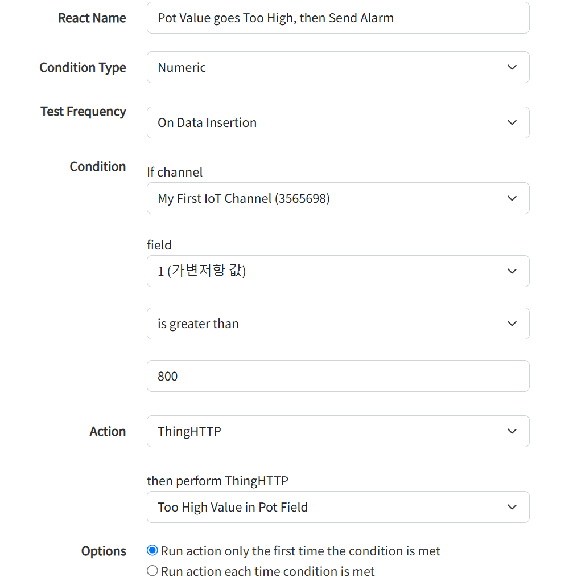
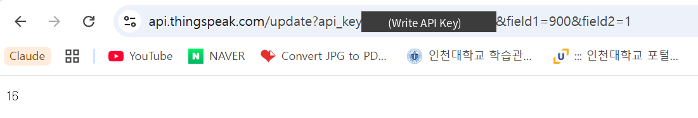
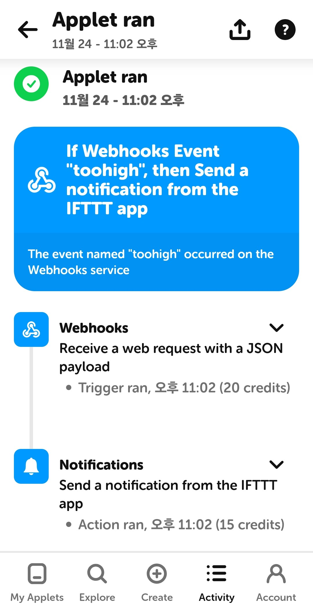
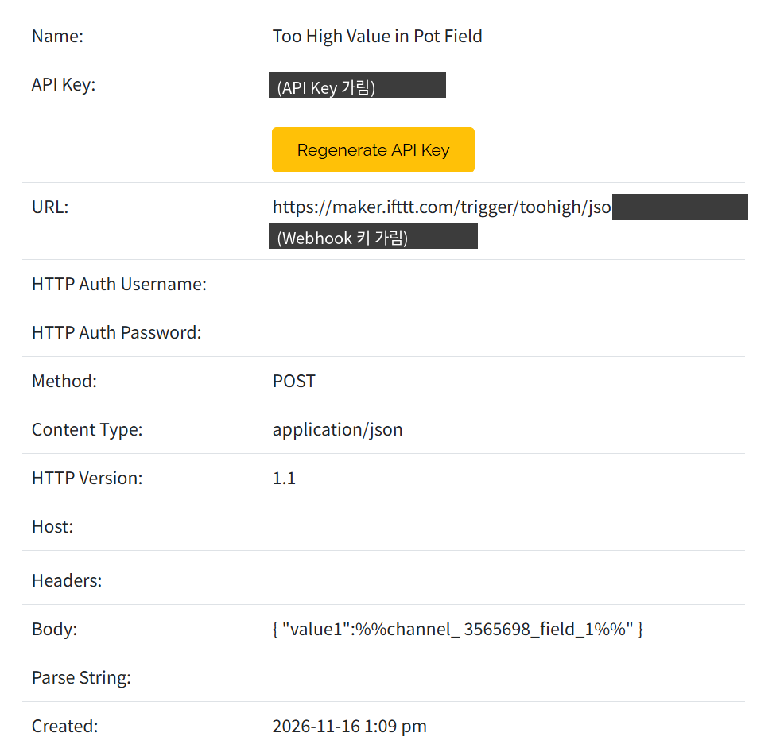

# ThingSpeak + IFTTT 알림 — 가변저항 값이 너무 높으면 휴대폰으로 알림

ThingSpeak 채널에 기록된 **가변저항 값(field 1)이 800을 넘으면**, ThingSpeak가 IFTTT Webhook을 호출하고, IFTTT가 **휴대폰 앱으로 알림**을 보내도록 연결했습니다.

```
API 요청으로 field1=900 기록
   → ThingSpeak React : "field 1 > 800" 조건 검사 (데이터가 들어올 때마다)
   → ThingSpeak ThingHTTP : IFTTT Webhook URL 호출 (이벤트 이름 toohigh)
   → IFTTT Applet : Webhook 이벤트 "toohigh"를 받으면
   → IFTTT 앱 알림 : 휴대폰에 알림 표시
```

| 단계 | 사용한 서비스 | 하는 일 |
|---|---|---|
| 1 | IFTTT Applet | Webhook 이벤트를 받으면 휴대폰 알림 보내기 |
| 2 | ThingSpeak 채널 | 가변저항 값(field 1), LED 상태(field 2) 기록 |
| 3 | ThingSpeak ThingHTTP | IFTTT Webhook URL을 호출하는 HTTP 요청 만들기 |
| 4 | ThingSpeak React | 조건(field 1 > 800)이 맞으면 ThingHTTP 실행 |
| 5 | ThingSpeak API Request | URL로 채널에 값 기록 (field1=900, field2=1) |
| 6 | 휴대폰 IFTTT 앱 | 알림 확인 |

---

## 1. IFTTT Applet 만들기



IFTTT 웹사이트에서 **Create**를 눌러 Applet을 만듭니다.

| 항목 | 설정 |
|---|---|
| If This (조건) | **Webhooks** → *Receive a web request with a JSON payload* |
| Event Name | `toohigh` |
| Then That (실행) | **Notifications** → *Send a notification from the IFTTT app* |

- 만든 뒤 Applet 이름은 **If Webhooks Event "toohigh", then Send a notification from the IFTTT app**이 됩니다.
- **Webhook 키**는 IFTTT의 Webhooks 서비스 페이지에서 **Documentation**을 누르면 확인할 수 있습니다.
- 호출할 주소는 아래 형식입니다.

```
https://maker.ifttt.com/trigger/toohigh/json/with/key/(Webhook 키)
```

- 주소 중간의 `/json/`은 "JSON payload를 받는 Webhook"이라는 뜻입니다. ThingSpeak가 보내는 JSON(`{"value1": ...}`)을 통째로 받습니다.
- Webhooks Documentation 페이지에서 이벤트 이름을 넣고 테스트하면, ThingSpeak 없이 IFTTT와 휴대폰 알림만 따로 확인할 수 있습니다.

---

## 2. ThingSpeak 채널



| 항목 | 값 |
|---|---|
| Channel ID | 3565698 |
| Name | My First IoT Channel |
| Field 1 | 가변저항 값 |
| Field 2 | LED 상태 |

---

## 3. ThingHTTP: IFTTT Webhook 연결

ThingSpeak 메뉴 **Apps → ThingHTTP → New ThingHTTP**에서 IFTTT를 부르는 HTTP 요청을 만듭니다.



| 항목 | 값 |
|---|---|
| Name | Too High Value in Pot Field |
| URL | `https://maker.ifttt.com/trigger/toohigh/json/with/key/(Webhook 키)` |
| Method | POST |
| Content Type | application/json |
| HTTP Version | 1.1 |
| Body | `{ "value1":"%%channel_3565698_field_1%%" }` |

- `%%channel_3565698_field_1%%`는 ThingSpeak가 요청을 보낼 때 **채널 3565698의 field 1 최신 값**으로 바꿔 줍니다.
- 예를 들어 field 1이 900이면 `{ "value1":"900" }`이 IFTTT로 전달됩니다.

---

## 4. React: ThingHTTP 호출 조건 등록

**Apps → React → New React**에서 언제 ThingHTTP를 실행할지 정합니다.



| 항목 | 값 |
|---|---|
| React Name | Pot Value goes Too High, then Send Alarm |
| Condition Type | Numeric |
| Test Frequency | On Data Insertion (데이터가 들어올 때마다 검사) |
| Condition | 채널 My First IoT Channel (3565698), field 1 (가변저항 값) **is greater than 800** |
| Action | ThingHTTP → Too High Value in Pot Field |
| Options | Run action only the first time the condition is met |

**Options 차이**
- *Run action only the first time the condition is met*: 조건이 맞은 **처음 한 번만** 실행합니다. 값이 800 이하로 내려갔다가 다시 넘어야 또 알림이 옵니다. 같은 경고가 계속 오는 것을 막을 수 있습니다.
- *Run action each time condition is met*: 800을 넘는 값이 들어올 때마다 실행합니다. 테스트할 때 편합니다.

---

## 5. API Request로 채널에 값 기록

**Channels → API Keys** 탭의 **Write API Key**와 API Requests 예시 URL을 이용해, 브라우저 주소창에서 값을 기록합니다.

```
https://api.thingspeak.com/update?api_key=(Write API Key)&field1=900&field2=1
```

- `field1=900`: 가변저항 값, `field2=1`: LED 상태(켜짐)



- 응답으로 나온 **16**은 이 채널의 16번째 기록이라는 뜻입니다. 이렇게 **1 이상의 숫자**(기록 번호)가 나오면 기록에 성공한 것이고, **0**이 나오면 기록되지 않은 것입니다.
- 무료 계정은 **15초에 한 번**만 기록할 수 있습니다. 15초 안에 다시 보내면 무시되고 0이 나옵니다.
- 900은 조건(800 초과)을 만족하므로 React → ThingHTTP → IFTTT 순서로 이어집니다.

---

## 6. 휴대폰에서 알림 확인



휴대폰 IFTTT 앱의 **Activity** 화면입니다. 값을 기록한 직후(11월 24일 오후 11:02) Applet이 실행된 기록이 남았습니다.

| 단계 | 결과 |
|---|---|
| Webhooks: *Receive a web request with a JSON payload* | **Trigger ran** — ThingSpeak가 보낸 `toohigh` 이벤트를 받음 |
| Notifications: *Send a notification from the IFTTT app* | **Action ran** — 휴대폰으로 알림 전송 |

알림을 받으려면 휴대폰 IFTTT 앱에 **같은 계정으로 로그인**하고, 휴대폰 설정에서 IFTTT 앱 알림을 허용해 두어야 합니다.

---

## 7. 고찰

### 문제 1. 값을 900으로 보냈는데 알림이 오지 않음

처음 만든 ThingHTTP의 Body가 아래처럼 잘못되어 있었습니다.



```
수정 전: { "value1":%%channel_ 3565698_field_1%%" }
수정 후: { "value1":"%%channel_3565698_field_1%%" }
```

- `channel_` 뒤에 **띄어쓰기**가 들어가 ThingSpeak가 이 부분을 가변저항 값으로 바꾸지 못했습니다.
- 바뀐 결과가 JSON이 아니어서, `/json/` Webhook으로 보내도 IFTTT가 제대로 처리하지 못했습니다.
- 값 앞의 **따옴표 `"`가 빠져** JSON 형식이 깨졌습니다.

### 문제 2. React가 다시 실행되지 않음

Options가 *Run action only the first time the condition is met*이어서, 한 번 조건이 맞은 뒤에는 값이 800 이하로 내려가기 전까지 다시 실행되지 않았습니다. 낮은 값을 먼저 기록하고 15초 뒤 900을 기록해 다시 확인했습니다.

### 문제를 찾은 방법

연결이 여러 단계(ThingSpeak → ThingHTTP → IFTTT → 휴대폰)라서, 어디서 끊겼는지 **한 단계씩 나눠서** 확인했습니다.
1. IFTTT Webhooks Documentation 페이지에서 직접 이벤트를 보내 IFTTT와 휴대폰 알림만 따로 확인
2. API 요청 응답이 0이 아닌지, 채널 그래프에 값이 찍혔는지 확인
3. 마지막으로 ThingHTTP와 React 설정 확인

### 배운 점과 개선 아이디어

- 코드를 한 줄도 쓰지 않고, 웹 서비스 설정만으로 "센서 값 → 조건 판단 → 알림"을 만들 수 있었습니다. 판단은 ThingSpeak가, 알림은 IFTTT가 나눠서 맡는 구조입니다.
- 지금은 브라우저로 값을 직접 기록했지만, 아두이노(ESP 보드 등)가 가변저항 값을 주기적으로 ThingSpeak에 보내면 실제 장치의 이상을 자동으로 감시할 수 있습니다.
- 값이 너무 낮을 때(예: 100 미만)를 위한 React를 하나 더 만들거나, 알림 대신 이메일이나 메신저로 보내도록 IFTTT의 실행 부분만 바꿔 확장할 수 있습니다.
